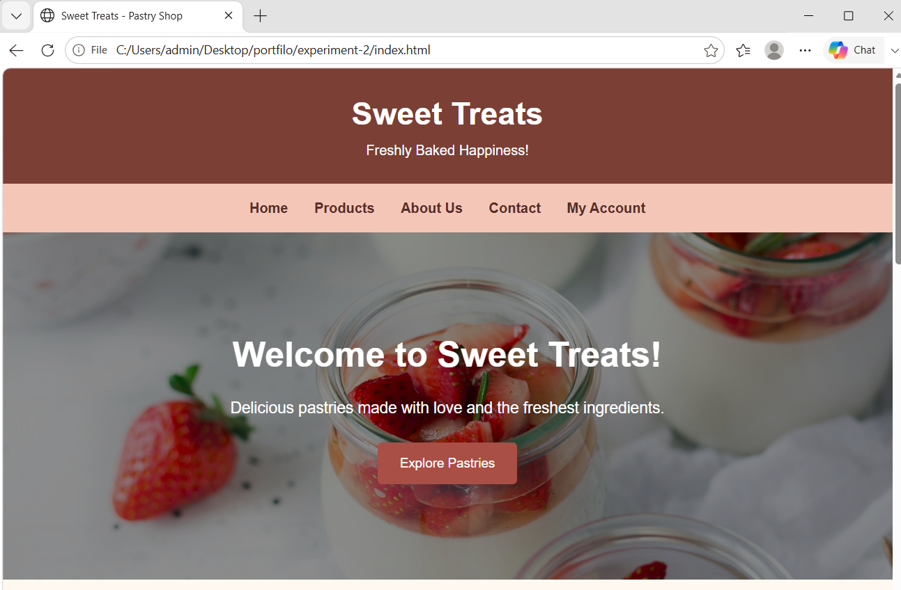

# Ex02 Commercial Website

## Date: 30.10.2026

## AIM
To create a commercial website using CSS Flexbox.

## ALGORITHM
### STEP 1
Create an HTML file (index.html)

### STEP 2
Create a CSS file (style.css)

### STEP 3
Include a navigation bar with links to different sections.

### STEP 4
Add structured sections for Homepage, Products / Services, About Us, Contact Details and User Account.

### STEP 5
Include social media links at the footer with copyright information.

### STEP 6
Define global styles for fonts, colors, and layout.

### STEP 7
Style the header, navigation bar, and sections.

### STEP 8
Use Flexbox for layout design.

### STEP 9
Add hover effects and transitions for interactivity.

### STEP 10
Add Images and Media.

### STEP 11
Use optimized images for a professional look.

### STEP 12
Open the HTML file in a browser to check layout and functionality.

### STEP 13
Fix styling issues and refine content placement.

### STEP 14
Deploy the website.

### STEP 15
Upload to GitHub Pages for free hosting.

## PROGRAM
 
index.html file

```
<!DOCTYPE html>
<html lang="en">
<head>
    <meta charset="UTF-8">
    <meta name="viewport" content="width=device-width, initial-scale=1.0">
    <title>Sweet Treats - Pastry Shop</title>
    <link rel="stylesheet" href="style.css">
</head>
<body>

    <!-- HEADER -->
    <header>
        <h1>Sweet Treats</h1>
        <p>Freshly Baked Happiness!</p>
    </header>

    <!-- NAVIGATION BAR -->
    <nav>
        <a href="#home">Home</a>
        <a href="#products">Products</a>
        <a href="#about">About Us</a>
        <a href="#contact">Contact</a>
        <a href="#account">My Account</a>
    </nav>

    <!-- HOMEPAGE -->
    <section id="home" class="hero">
        <div class="hero-content">
            <h2>Welcome to Sweet Treats!</h2>
            <p>Delicious pastries made with love and the freshest ingredients.</p>
            <a href="#products" class="btn">Explore Pastries</a>
        </div>
    </section>

    <!-- PRODUCTS SECTION -->
    
<!-- PRODUCTS SECTION -->
<section id="products">
    <h2>Our Delicious Pastries</h2>
    <p class="subtitle">Taste the sweetness in every bite!</p>

    <div class="product-container">

        <div class="product-card">
            
            <h3>Chocolate Pastry</h3>
            <p>Rich and creamy chocolate delight.</p>
            <h4>₹120</h4>
            <a href="#contact" class="btn">Order Now</a>
        </div>

        <div class="product-card">
            
            <h3>Strawberry Pastry</h3>
            <p>Fresh strawberry with soft cream.</p>
            <h4>₹100</h4>
            <a href="#contact" class="btn">Order Now</a>
        </div>

        <div class="product-card">
            
            <h3>Butter Croissant</h3>
            <p>Flaky, buttery and freshly baked.</p>
            <h4>₹90</h4>
            <a href="#contact" class="btn">Order Now</a>
        </div>

        <div class="product-card">
            
            <h3>Vanilla Cupcake</h3>
            <p>Soft vanilla cake with sweet frosting.</p>
            <h4>₹80</h4>
            <a href="#contact" class="btn">Order Now</a>
        </div>

    </div>
</section>


    <!-- ABOUT US SECTION -->
    <section id="about">
        <h2>About Us</h2>
        <div class="about-content">
            <p>
                Welcome to Sweet Treats, your favourite pastry destination!
                We prepare fresh and delicious pastries using quality
                ingredients. Our goal is to make every celebration special
                with our tasty bakery products. From chocolate pastries to
                creamy cupcakes, we have something for everyone.
            </p>
        </div>
    </section>

    <!-- CONTACT SECTION -->
    <section id="contact">
        <h2>Contact Us</h2>
        <div class="contact-box">
            <p><strong>Address:</strong> Chennai, Tamil Nadu</p>
            <p><strong>Phone:</strong> +91 98765 43210</p>
            <p><strong>Email:</strong> sweettreats@gmail.com</p>

            <form>
                <input type="text" placeholder="Enter your name" required>
                <input type="email" placeholder="Enter your email" required>
                <textarea placeholder="Your message" rows="4" required></textarea>
                <button type="submit" class="btn">Send Message</button>
            </form>
        </div>
    </section>

    <!-- USER ACCOUNT SECTION -->
    <section id="account">
        <h2>My Account</h2>
        <div class="account-box">
            <form>
                <input type="email" placeholder="Email Address" required>
                <input type="password" placeholder="Password" required>
                <button type="submit" class="btn">Login</button>
            </form>
            <p>New customer? Create an account with us!</p>
        </div>
    </section>

    <!-- FOOTER -->
    <footer>
        <h3>Sweet Treats</h3>
        <p>Follow us on social media</p>
        <div class="social-links">
            <a href="https://www.instagram.com/">Instagram</a>
            <a href="https://www.facebook.com/">Facebook</a>
            <a href="https://www.youtube.com/">YouTube</a>
        </div>
        <p>&copy; 2026 Sweet Treats. All Rights Reserved.</p>
    </footer>

</body>
</html>

```

style.css file

```

/* GLOBAL STYLES */
* {
    margin: 0;
    padding: 0;
    box-sizing: border-box;
    scroll-behavior: smooth;
}

body {
    font-family: Arial, sans-serif;
    background-color: #fff8f0;
    color: #4b2929;
    line-height: 1.6;
}

/* HEADER */
header {
    background-color: #7b3f35;
    color: white;
    text-align: center;
    padding: 25px;
}

header h1 {
    font-size: 36px;
}

header p {
    font-size: 16px;
}

/* NAVIGATION BAR */
nav {
    background-color: #f3c6b8;
    display: flex;
    justify-content: center;
    flex-wrap: wrap;
    padding: 15px;
    gap: 30px;
    position: sticky;
    top: 0;
    z-index: 10;
}

nav a {
    color: #572d28;
    text-decoration: none;
    font-weight: bold;
    transition: 0.3s;
}

nav a:hover {
    color: #ffffff;
}

/* COMMON SECTION STYLES */
section {
    padding: 60px 8%;
    text-align: center;
}

section h2 {
    font-size: 30px;
    color: #7b3f35;
    margin-bottom: 15px;
}

.subtitle {
    margin-bottom: 30px;
}

/* HOMEPAGE */
.hero {
    min-height: 400px;
    background: linear-gradient(
        rgba(0, 0, 0, 0.45),
        rgba(0, 0, 0, 0.45)
    ),
    url("https://images.unsplash.com/photo-1488477181946-6428a0291777?w=1600")
    center/cover no-repeat;
    display: flex;
    align-items: center;
    justify-content: center;
    color: white;
}

.hero-content h2 {
    color: white;
    font-size: 40px;
}

.hero-content p {
    margin: 15px 0 25px;
    font-size: 18px;
}

/* BUTTON */
.btn {
    display: inline-block;
    background-color: #a94f45;
    color: white;
    text-decoration: none;
    border: none;
    padding: 12px 25px;
    border-radius: 5px;
    cursor: pointer;
    font-size: 15px;
    transition: 0.3s;
}

.btn:hover {
    background-color: #71352e;
    transform: translateY(-3px);
}


/* PRODUCTS */

.product-container {
    display: flex;
    flex-direction: row;
    justify-content: center;
    flex-wrap: wrap;
    gap: 25px;
    margin-top: 30px;
}

.product-card {
    background-color: white;
    width: 250px;
    padding: 15px;
    border-radius: 12px;
    box-shadow: 0 4px 12px rgba(0, 0, 0, 0.12);
    transition: 0.3s;
}

.product-card:hover {
    transform: translateY(-8px);
}

.product-card img {
    width: 100%;
    height: 180px;
    object-fit: cover;
    border-radius: 8px;
}


/* ABOUT US */
#about {
    background-color: #fbe5dc;
}

.about-content {
    max-width: 800px;
    margin: auto;
    font-size: 17px;
}

/* CONTACT */
#contact {
    background-color: #fff8f0;
}

.contact-box {
    max-width: 500px;
    margin: auto;
}

.contact-box p {
    margin: 10px;
}

form {
    display: flex;
    flex-direction: column;
    gap: 15px;
    margin-top: 20px;
}

input, textarea {
    padding: 12px;
    border: 1px solid #d8aaa0;
    border-radius: 5px;
    font-size: 15px;
    width: 100%;
}

/* USER ACCOUNT */
#account {
    background-color: #fbe5dc;
}

.account-box {
    max-width: 400px;
    margin: auto;
}

.account-box p {
    margin-top: 15px;
}

/* FOOTER */
footer {
    background-color: #7b3f35;
    color: white;
    text-align: center;
    padding: 25px;
}

footer h3 {
    font-size: 25px;
    margin-bottom: 10px;
}

.social-links {
    margin: 15px;
}

.social-links a {
    color: #ffd8c9;
    text-decoration: none;
    margin: 10px;
    transition: 0.3s;
}

.social-links a:hover {
    color: white;
    text-decoration: underline;
}

/* RESPONSIVE DESIGN */

@media (max-width: 600px) {
    nav {
        gap: 15px;
    }

    .hero-content h2 {
        font-size: 28px;
    }

    section {
        padding: 40px 5%;
    }

    .product-card {
        width: calc(50% - 10px);
        min-width: 0;
        flex: 0 0 calc(50% - 10px);
    }
}

@media (max-width: 350px) {
    .product-card {
        width: 100%;
        flex: 0 0 100%;
    }
}

```


## OUTPUT




## RESULT
The program for creating commercial website using CSS Flexbox is executed successfully.
